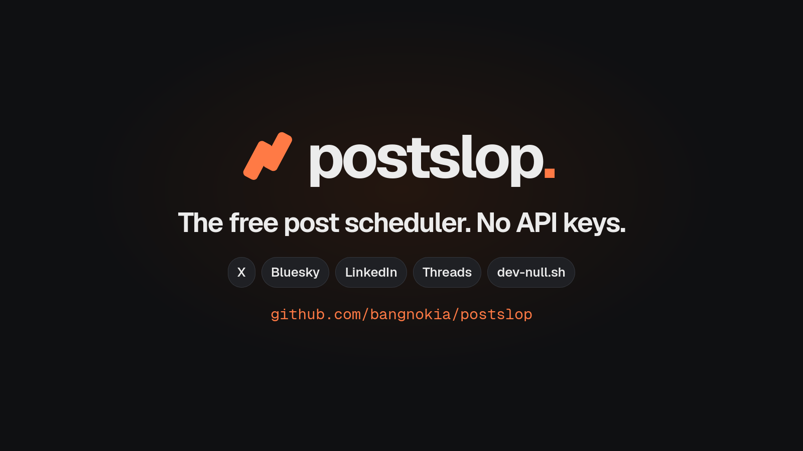

# Postslop



**Write once, post everywhere.** Postslop is a free, open-source post scheduler for X, Bluesky, LinkedIn, Threads and dev-null.sh. It needs no API keys: it posts with the accounts you are already signed in to in your browser. Run it on your computer or on your own server.

Threads support is experimental, and publishing to it live has not been verified yet. See [Threads](docs/threads.md).

## Install

You need PHP 8.4+ with the `fileinfo` and `gd` extensions, Composer, and Node 22+. With those installed, setup takes about 5 minutes.

```sh
git clone https://github.com/bangnokia/postslop.git
cd postslop
composer deps            # install dependencies
composer setup           # create server/.env, private storage and the database
composer browser:setup   # the private browser Postslop uses to post to X
composer build           # build the web client
```

## Setup

1. **Choose your access token.** Open `server/.env` and replace `change-me` in `POSTSLOP_TOKEN` with a password of your own. The web client asks for it once. If you leave it empty, anyone who can reach Postslop can use it.
2. **Connect your accounts.** Sign in to your sites in Chrome (macOS) or Firefox, then import them:

   ```sh
   composer accounts:import                        # from Chrome
   composer accounts:import -- --browser=firefox   # or from Firefox
   ```

   Postslop asks which account is signed in on each site. On macOS, choose Allow when asked about "Chrome Safe Storage".
3. **Check them.** `composer accounts` shows which accounts are ready.

## Getting started

```sh
composer start
```

Open <http://127.0.0.1:8087> and enter your access token. Press <kbd>C</kbd> to write a post, pick the sites and add images, then publish it now, schedule it, or save it as a draft. Scheduled posts go out while Postslop is running; `composer stop` stops it.

- **Raycast** (macOS): write and publish without leaving Raycast. Install it with `composer raycast:install` and `composer raycast:dev`. See the [Raycast guide](clients/raycast/README.md).
- **AI agents**: connect an MCP client to `https://YOUR_SERVER/api/v1/mcp` with your access token. Agents save drafts by default; scheduling and publishing are separate, explicit steps. See [MCP](docs/mcp.md) and the [agent guide](docs/agents.md).
- **Postslop on a server**: install it there the same way and put HTTPS in front of it. Then send your accounts from the computer with your browser, without a checkout: with [cpx](https://github.com/laravel/cpx) and PHP 8.2+, set `POSTSLOP_REMOTE_TOKEN` to the server's access token and run `cpx bangnokia/postslop setup --to=https://YOUR_SERVER`. See the [remote account client](clients/cli/README.md).

## Documentation

- [Accounts](docs/accounts.md): importing, checking and managing accounts
- [Web client](docs/web-client.md)
- [Raycast](clients/raycast/README.md)
- [Command line](docs/cli.md)
- [MCP for AI agents](docs/mcp.md) and the [agent guide](docs/agents.md)
- [Remote account client](clients/cli/README.md)
- [HTTP API](docs/api.md)
- [Threads](docs/threads.md)
- [Running and developing Postslop](docs/development.md): architecture, server commands, scheduling, privacy and checks
- [Testing against fake sites](docs/testing.md)
- [Releasing](docs/releasing.md)

## License

[MIT](LICENSE)
